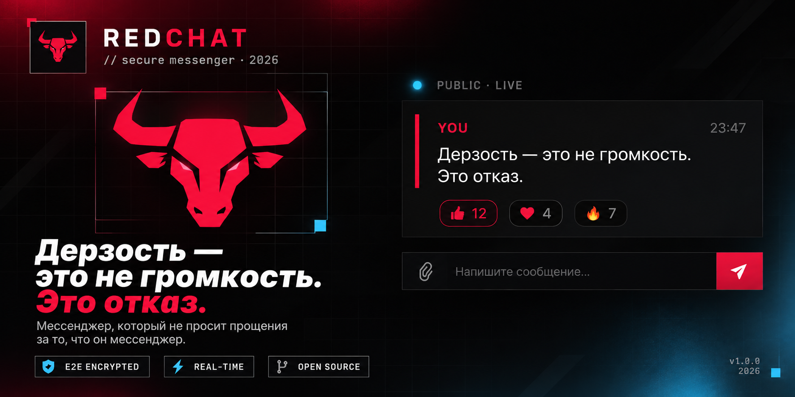
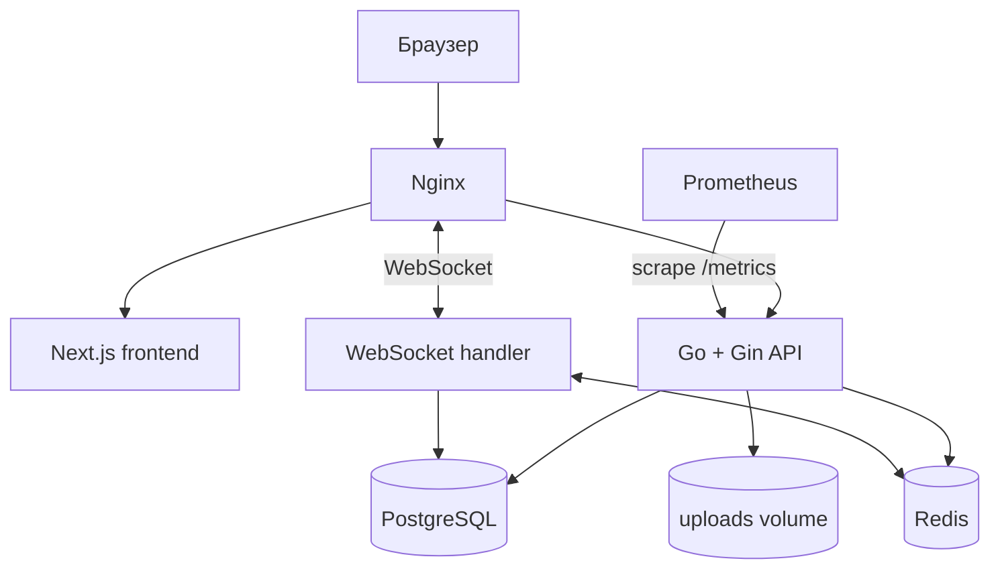

<p align="center">
  
</p>
<h1 align="center">REDCHAT</h1>

<div align="center">

# REDCHAT

### Острые углы. Один алый. Бык без улыбки.

**Мессенджер, в котором уважение выражается точностью.**

`// DIALOGS` · `// MESSAGES` · `// CONNECTION`

<br />

[Функции](#функциональность) · [Архитектура](#архитектура) · [Запуск](#запуск) · [API](#api) · [Манифест](#манифест)

</div>

---

> **Уважение — это не улыбка. Это точность.**
>
> RedChat — full-stack мессенджер с общими и личными диалогами, сообщениями в реальном времени и прямым визуальным языком. Он не пытается понравиться каждому. Он стремится быть понятным, собранным и надёжным в повседневном использовании.

## О проекте

RedChat — приложение для общения, в котором интерфейс остаётся спокойным, а действия обозначены явно. Пользователь может создать аккаунт, настроить профиль, найти собеседника, начать личный диалог, обмениваться сообщениями и файлами, редактировать свои сообщения и реагировать на сообщения других участников.

Проект построен как самостоятельное full-stack приложение:

- **Frontend** отвечает за интерфейс, маршрутизацию и серверное состояние.
- **Backend** предоставляет HTTP API, проверяет права доступа и сохраняет данные.
- **PostgreSQL** хранит пользователей, сессии, диалоги, сообщения, реакции и метаданные файлов.
- **Redis** ограничивает частоту auth-запросов и передаёт события между экземплярами backend.
- **WebSocket** доставляет новые события подключённым пользователям.
- **Nginx** выступает единой точкой входа для frontend, API и WebSocket.

## Функциональность

### Аккаунт и профиль

- Регистрация и вход по имени пользователя и паролю.
- Проверка текущей сессии и выход из аккаунта.
- Редактирование имени пользователя и описания профиля.
- Загрузка аватара: JPG, PNG, WEBP и GIF, до 5 МБ.
- Сессионная авторизация через HttpOnly cookie.

### Диалоги и сообщения

- Общий чат и личные диалоги один на один.
- Поиск пользователей по имени.
- Создание личного диалога или получение уже существующего.
- Получение истории с cursor pagination по `before_id`.
- Отправка сообщений через WebSocket и HTTP API.
- Редактирование и удаление собственных сообщений.
- Реакции: `👍` `❤️` `😂` `😮` `😢` `🔥`.
- Прикрепление файлов до 15 МБ.
- Защищённое скачивание вложений с проверкой авторизации и участия в диалоге.

### Real-time и инфраструктура

- WebSocket-события для новых, изменённых и удалённых сообщений, реакций и вложений.
- Redis Pub/Sub для доставки событий между экземплярами backend.
- Origin allowlist для WebSocket и CORS.
- Redis rate limiting для регистрации и входа.
- Health check и метрики Prometheus.
- Автоматический запуск SQL-миграций при старте backend.

## Технологический стек

| Область | Технологии |
|---|---|
| Frontend | Next.js App Router, React, TypeScript |
| Архитектура frontend | Feature-Sliced Design (FSD) |
| Server state | TanStack Query |
| Стилизация | Tailwind CSS |
| Backend | Go, Gin |
| База данных | PostgreSQL 16 |
| Кеш, rate limiting и Pub/Sub | Redis 7 |
| Real-time | WebSocket, Gorilla WebSocket |
| Reverse proxy | Nginx |
| Мониторинг | Prometheus |
| Контейнеризация | Docker, Docker Compose |

## Архитектура



### Frontend — FSD

```text
front/src/
├── app/          # Next.js routes, layout, providers
├── entities/     # User, Message, Conversation
├── features/     # Auth, chat, conversations, messages, profile
├── shared/       # API client и общая инфраструктура
└── widgets/      # ChatPage, AuthForm, ProfileModal
```

Серверное состояние пользователя, диалогов и сообщений управляется через TanStack Query. Это позволяет централизовать загрузку, кеширование, обновление и инвалидацию данных, не дублируя серверное состояние в Redux.

### Backend — Go

```text
back/
├── cmd/api/                  # Точка входа
└── internal/
    ├── auth/                 # Регистрация, сессии, профиль
    ├── chat/                 # Диалоги, сообщения, файлы, WebSocket, Pub/Sub
    ├── config/               # Конфигурация из ENV
    ├── httpserver/           # Gin router и middleware
    └── store/
        ├── migrate.go        # Запуск миграций
        └── migrations/       # SQL-схема
```

PostgreSQL является источником истины для данных приложения. Redis Pub/Sub используется как транспорт событий между backend-экземплярами, а не как замена базе данных.

## Поток real-time событий

1. Клиент устанавливает WebSocket-соединение с `/ws` и проходит проверку сессионной cookie.
2. Backend проверяет `Origin` по точному списку `ALLOWED_ORIGINS`.
3. При отправке сообщения backend сохраняет его в PostgreSQL.
4. Событие публикуется в Redis Pub/Sub.
5. Каждый backend-экземпляр получает событие и отправляет его только локально подключённым пользователям из списка получателей.

Для личного диалога получателями события являются только его участники. Для общего чата событие доступно участникам общего чата.

## Безопасность и границы доверия

- Пароли хешируются с помощью **Argon2id**.
- Сессионный токен передаётся в **HttpOnly cookie**; в PostgreSQL хранится его SHA-256-хеш.
- Для изменяющих состояние HTTP-запросов применяется **CSRF-токен** в `X-CSRF-Token`.
- Регистрация и вход ограничиваются по IP через Redis rate limiting.
- WebSocket принимает только Origin из точного allowlist; отсутствующий Origin отклоняется.
- Изменять и удалять можно только собственные сообщения.
- Получать вложения могут только авторизованные участники соответствующего диалога.
- Размер аватара ограничен 5 МБ, размер вложения — 15 МБ.


## Манифест

### I. Уважение — это точность

Мы не заставляем пользователя пробираться сквозь декоративный шум. Названия действий, состояния и ошибки должны говорить прямо. Хороший интерфейс не заискивает — он помогает понять, что происходит.

### II. Один алый — одна воля

У RedChat один основной акцентный цвет: **`#E11D48`**. Он обозначает действие, выбор и принадлежность к системе.

| Цвет | Роль |
|---|---|
| `#E11D48` | Алый — действие и акцент |
| `#0A0A0A` | Уголь — основное пространство |
| `#18181B` | Графит — поверхности и уровни |
| `#38BDF8` | Стальной — состояние и обратная связь |

Алый отвечает на вопрос «что делать?». Стальной — «где я и что происходит?».

### III. Бык не улыбается первым

Голова быка — знак RedChat. Это не декоративный маскот, а образ устойчивости и прямого взгляда. Не агрессия ради агрессии, а упрямство формы: позиция должна быть ясной, а обещания — подкреплёнными реализацией.

### IV. Пустота — часть интерфейса

`#0A0A0A` — не просто тёмная тема. Это пространство, в котором важное получает фокус. Графитовые поверхности задают иерархию, а свободное место помогает не перегружать внимание.

### V. Границы должны быть видны

Права доступа, состояния соединения, ошибки и границы диалога не должны быть спрятаны за неопределёнными формулировками. Уважение начинается с ясности: где заканчивается интерфейс и где начинается ответственность системы.

### VI. Дерзость наружу — ответственность внутрь

Визуальная строгость не освобождает от бережного отношения к данным. Приватность — не слоган в футере, а набор конкретных решений: безопасные сессии, CSRF-защита, проверка Origin и контроль доступа к вложениям. Всё, что ещё не реализовано, нельзя выдавать за обещанную защиту.

### VII. Формула RedChat

> **Дерзость без доверия — хамство.**  
> **Доверие без дерзости — слабость.**  
> **RedChat — там, где эти два сходятся.**

**Острые углы. Один алый. Бык без улыбки.**  
**`//` без объяснений.**

## Запуск

### Требования

- Docker Desktop с Docker Compose plugin.
- Свободные порты `80` и `9090`.

### 1. Получить проект и перейти в корень

```bash
git clone <repository-url>
cd redchat
```

Если проект уже скачан архивом, достаточно распаковать его и открыть папку `redchat`.

### 2. Создать `.env`

PowerShell:

```powershell
Copy-Item .env.example .env
```

Linux / macOS:

```bash
cp .env.example .env
```

Для локального запуска значения из `.env.example` подходят как стартовые. Перед публикацией проекта обязательно замени пароли и настрой origin.

### 3. Собрать и запустить контейнеры

```bash
docker compose up --build -d
```

Посмотреть состояние:

```bash
docker compose ps
```

Посмотреть логи:

```bash
docker compose logs -f back
```

### 4. Открыть приложение

| Сервис | Адрес |
|---|---|
| RedChat | [http://localhost](http://localhost) |
| Prometheus | [http://localhost:9090](http://localhost:9090) |

Создай два аккаунта в разных браузерах или профилях, чтобы проверить личные диалоги и доставку сообщений в реальном времени.

### Остановка

```bash
docker compose down
```

Команда выше сохраняет данные в Docker volumes. **Не используй `docker compose down -v`, если нужно сохранить пользователей, сообщения и загруженные файлы.**

## Переменные окружения

| Переменная | Назначение | Локальное значение по умолчанию |
|---|---|---|
| `APP_ENV` | Режим приложения | `development` |
| `HTTP_ADDR` | Адрес Go HTTP-сервера | `:8080` |
| `FRONTEND_ORIGIN` | Origin frontend для CORS | `http://localhost` |
| `ALLOWED_ORIGINS` | Точный список разрешённых Origin для WebSocket/CORS | `http://localhost` |
| `DB_USER` | Пользователь PostgreSQL | `redchat` |
| `DB_PASSWORD` | Пароль PostgreSQL | `change_me_local` |
| `DB_NAME` | Имя базы данных | `redchat` |
| `REDIS_PASSWORD` | Пароль Redis; пустое значение отключает пароль | пусто |

Для запуска Next.js отдельно в dev-режиме на `http://localhost:3000` добавь этот origin в `ALLOWED_ORIGINS` и настрой `FRONTEND_ORIGIN` на тот же адрес.

## API

Все HTTP-маршруты приложения находятся под `/api`.

### Авторизация и профиль

| Метод | Endpoint | Назначение |
|---|---|---|
| `POST` | `/auth/register` | Регистрация |
| `POST` | `/auth/login` | Вход и установка сессии |
| `POST` | `/auth/logout` | Выход и отзыв сессии |
| `GET` | `/auth/me` | Текущий пользователь и CSRF-токен |
| `PUT` | `/auth/profile` | Изменение имени и описания |
| `POST` | `/auth/avatar` | Загрузка аватара |

### Пользователи и диалоги

| Метод | Endpoint | Назначение |
|---|---|---|
| `GET` | `/users?q=...` | Поиск пользователей |
| `GET` | `/conversations` | Список диалогов |
| `POST` | `/conversations/direct` | Создать или получить личный диалог |

### Сообщения и вложения

| Метод | Endpoint | Назначение |
|---|---|---|
| `GET` | `/conversations/:id/messages?limit=30&before_id=...` | История с cursor pagination |
| `POST` | `/conversations/:id/messages` | Отправить текстовое сообщение |
| `POST` | `/conversations/:id/files` | Отправить файл |
| `GET` | `/files/:id` | Скачать вложение с проверкой доступа |
| `PUT` | `/messages/:id` | Редактировать своё сообщение |
| `DELETE` | `/messages/:id` | Удалить своё сообщение |
| `POST` | `/messages/:id/reactions` | Переключить реакцию |

### Инфраструктура

| Метод | Endpoint | Назначение |
|---|---|---|
| `GET` | `/ws` | WebSocket-соединение |
| `GET` | `/health` | Health check |
| `GET` | `/metrics` | Метрики Prometheus |

Небезопасные HTTP-запросы требуют CSRF-заголовок `X-CSRF-Token`. Токен получают из ответа `/api/auth/login` или `/api/auth/me`.

## WebSocket

Клиент подключается к `/ws` с той же сессионной cookie. Для отправки текста используется JSON-событие:

```json
{
  "type": "message",
  "conversation_id": "<conversation-id>",
  "content": "Привет"
}
```

События создания, редактирования, удаления, реакций и вложений доставляются подключённым участникам через backend и Redis Pub/Sub.

## Хранение данных

Docker Compose создаёт именованные volumes:

| Volume | Содержимое |
|---|---|
| `postgres_data` | Данные PostgreSQL |
| `redis_data` | Данные Redis |
| `uploads_data` | Аватары и вложения |
| `prometheus_data` | Данные Prometheus |

SQL-миграции хранятся в `back/internal/store/migrations/` и выполняются автоматически при старте backend. Не удаляй volumes при обычном обновлении приложения.

## Известные ограничения

- Личные диалоги — один на один; групповые диалоги не входят в текущую версию.
- Сквозное E2E-шифрование не реализовано.
- Вложения хранятся в локальном Docker volume. Для распределённого production-развёртывания лучше использовать S3-совместимое object storage.
- Redis Pub/Sub обеспечивает межэкземплярную доставку событий, но не хранит историю сообщений.
- Для production необходимы HTTPS/TLS, надёжные секреты, точный `ALLOWED_ORIGINS`, резервное копирование PostgreSQL и хранилища файлов.
- Перед публичным развёртыванием требуется отдельное тестирование безопасности и нагрузочное тестирование.

## Roadmap

- [ ] Сквозное E2E-шифрование с управлением ключами и проверкой устройств.
- [ ] Групповые диалоги.
- [ ] Хранение вложений в S3-совместимом объектном хранилище.
- [ ] Автоматическая подгрузка истории при прокрутке вверх.
- [ ] Тесты API, интеграционные тесты WebSocket и сценарии конкурентной доставки.

---

<div align="center">

**REDCHAT · 2026**

`#E11D48` · `#0A0A0A` · `#18181B` · `#38BDF8`

*Это не стиль. Это позиция.*

</div>
