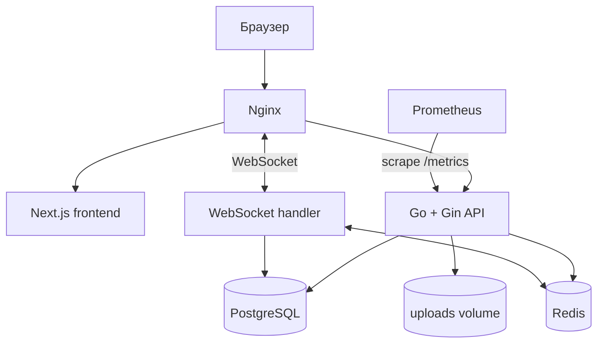

<p align="center">
  
</p>
<h1 align="center">REDCHAT</h1>

<div align="center">

[Функции](#функциональность) · [Архитектура](#архитектура) · [Запуск](#запуск) · [API](#api) · [Манифест](#манифест)
</div>
<p align="center">
  
  
  
  
  
  
</p>

---

> **Уважение — это не улыбка. Это точность.**
>
> RedChat — full-stack мессенджер с общими и личными диалогами, сообщениями в реальном времени и прямым визуальным языком. Он не пытается понравиться каждому. Он стремится быть понятным, собранным и надёжным в повседневном использовании.

## О проекте

RedChat — приложение для общения, в котором интерфейс остаётся спокойным, а действия обозначены явно. Пользователь может создать аккаунт, настроить профиль, найти собеседника, начать личный диалог, обмениваться сообщениями и файлами, редактировать свои сообщения и реагировать на сообщения других участников.

Проект построен как самостоятельное full-stack приложение:

- **Frontend** отвечает за интерфейс, маршрутизацию и серверное состояние.
- **Backend** предоставляет HTTP API, проверяет права доступа и сохраняет данные.
- **PostgreSQL** хранит пользователей, сессии, диалоги, сообщения, реакции и метаданные файлов.
- **Redis** ограничивает частоту auth-запросов и передаёт события между экземплярами backend.
- **WebSocket** доставляет новые события подключённым пользователям.
- **Nginx** выступает единой точкой входа для frontend, API и WebSocket.

## Функциональность

### Аккаунт и профиль

- Регистрация и вход по имени пользователя и паролю.
- Проверка текущей сессии и выход из аккаунта.
- Редактирование имени пользователя и описания профиля.
- Загрузка аватара: JPG, PNG, WEBP и GIF, до 5 МБ.
- Сессионная авторизация через HttpOnly cookie.

### Диалоги и сообщения

- Общий чат и личные диалоги один на один.
- Поиск пользователей по имени.
- Создание личного диалога или получение уже существующего.
- Получение истории с cursor pagination по `before_id`.
- Отправка сообщений через WebSocket и HTTP API.
- Редактирование и удаление собственных сообщений.
- Реакции: `👍` `❤️` `😂` `😮` `😢` `🔥`.
- Прикрепление файлов до 15 МБ.
- Защищённое скачивание вложений с проверкой авторизации и участия в диалоге.

### Real-time и инфраструктура

- WebSocket-события для новых, изменённых и удалённых сообщений, реакций и вложений.
- Redis Pub/Sub для доставки событий между экземплярами backend.
- Origin allowlist для WebSocket и CORS.
- Redis rate limiting для регистрации и входа.
- Health check и метрики Prometheus.
- Автоматический запуск SQL-миграций при старте backend.

## Технологический стек

| Область | Технологии |
|---|---|
| Frontend | Next.js App Router, React, TypeScript |
| Архитектура frontend | Feature-Sliced Design (FSD) |
| Server state | TanStack Query |
| Стилизация | Tailwind CSS |
| Backend | Go, Gin |
| База данных | PostgreSQL 16 |
| Кеш, rate limiting и Pub/Sub | Redis 7 |
| Real-time | WebSocket, Gorilla WebSocket |
| Reverse proxy | Nginx |
| Мониторинг | Prometheus |
| Контейнеризация | Docker, Docker Compose |

## Архитектура



### Frontend — FSD

```text
front/src/
├── app/          # Next.js routes, layout, providers
├── entities/     # User, Message, Conversation
├── features/     # Auth, chat, conversations, messages, profile
├── shared/       # API client и общая инфраструктура
└── widgets/      # ChatPage, AuthForm, ProfileModal
```

Серверное состояние пользователя, диалогов и сообщений управляется через TanStack Query. Это позволяет централизовать загрузку, кеширование, обновление и инвалидацию данных, не дублируя серверное состояние в Redux.

### Backend — Go

```text
back/
├── cmd/api/                  # Точка входа
└── internal/
    ├── auth/                 # Регистрация, сессии, профиль
    ├── chat/                 # Диалоги, сообщения, файлы, WebSocket, Pub/Sub
    ├── config/               # Конфигурация из ENV
    ├── httpserver/           # Gin router и middleware
    └── store/
        ├── migrate.go        # Запуск миграций
        └── migrations/       # SQL-схема
```

PostgreSQL является источником истины для данных приложения. Redis Pub/Sub используется как транспорт событий между backend-экземплярами, а не как замена базе данных.

## Поток real-time событий

1. Клиент устанавливает WebSocket-соединение с `/ws` и проходит проверку сессионной cookie.
2. Backend проверяет `Origin` по точному списку `ALLOWED_ORIGINS`.
3. При отправке сообщения backend сохраняет его в PostgreSQL.
4. Событие публикуется в Redis Pub/Sub.
5. Каждый backend-экземпляр получает событие и отправляет его только локально подключённым пользователям из списка получателей.

Для личного диалога получателями события являются только его участники. Для общего чата событие доступно участникам общего чата.

## Безопасность и границы доверия

- Пароли хешируются с помощью **Argon2id**.
- Сессионный токен передаётся в **HttpOnly cookie**; в PostgreSQL хранится его SHA-256-хеш.
- Для изменяющих состояние HTTP-запросов применяется **CSRF-токен** в `X-CSRF-Token`.
- Регистрация и вход ограничиваются по IP через Redis rate limiting.
- WebSocket принимает только Origin из точного allowlist; отсутствующий Origin отклоняется.
- Изменять и удалять можно только собственные сообщения.
- Получать вложения могут только авторизованные участники соответствующего диалога.
- Размер аватара ограничен 5 МБ, размер вложения — 15 МБ.

###  Формула RedChat

> **Дерзость без доверия — хамство.**  
> **Доверие без дерзости — слабость.**  
> **RedChat — там, где эти два сходятся.**

**Дерзкий акцент. Четкие грани. Фокус на главном.** 
**`//` без объяснений.**

## Быстрый запуск

**Требования:** Docker Desktop (с Compose) и свободные порты `80`, `9090`.

1. **Клонировать репозиторий и создать конфиг:**
   ```bash
   git clone <repository-url>
   cd redchat
   cp .env.example .env # для PowerShell: Copy-Item .env.example .env
   ```

2. **Собрать и запустить:**
   ```bash
   docker compose up --build -d
   ```

3. **Открыть в браузере:**
   - **Приложение:** [http://localhost](http://localhost) (создайте два аккаунта в разных браузерах для теста)
   - **Метрики Prometheus:** [http://localhost:9090](http://localhost:9090)

4. **Полезные команды:**
   - Логи бэкенда: `docker compose logs -f back`
   - Остановка с сохранением данных: `docker compose down` *(флаг `-v` удалит базу и файлы)*


---

<div align="center">

**REDCHAT · 2026**

*Это не стиль. Это позиция.*

</div>
